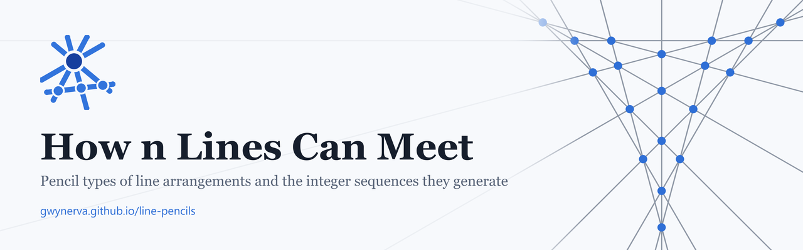

<h1>
  <picture>
    <source media="(prefers-color-scheme: dark)" srcset="docs/assets/banner-dark.png">
    
  </picture>
</h1>

[](https://github.com/Gwynerva/line-pencils/actions/workflows/verify.yml)

Draw *n* straight lines, no two parallel. At every intersection point write down how many lines pass through it.
The multiset of these numbers is the **pencil type** of the arrangement. Which types occur, and how many for each *n*?

Three sieves — arithmetic, combinatorics (linear spaces), real geometry — give three integer sequences; a fourth
counts how many different numbers of intersection points *n* lines can have. The first is A072964; the other three
were new and are now OEIS entries A400149, A399464 and A399605.

| sequence | n = 1, 2, 3, … | status |
|---|---|---|
| a(n) arithmetically admissible types | 1, 1, 2, 4, 7, 15, 32, 66, 141, 295, 619, 1286, 2654, … | = A072964(n−1) |
| b(n) ways n lines can meet, consistent with "two lines meet only once" | 1, 1, 2, 3, 5, 9, 17, 29, 56, 106, 202, 384 | computed through n = 12; [A400149](https://oeis.org/A400149) |
| c(n) ways n lines in the plane can meet | 1, 1, 2, 3, 5, 9, 16, 28, 53, 98, 180, 336 | computed through n = 12; 620 ≤ c(13) ≤ 659, c(14) ≥ 1104; [A399464](https://oeis.org/A399464) |
| d(n) different possible numbers of intersection points | 1, 1, 2, 3, 5, 9, 13, 18, 24, 30, 38, 46, 56 | computed through n = 13; [A399605](https://oeis.org/A399605) |

The write-up — definitions, theorems with proofs, algorithms, a gallery of every known realizable type for 1 to 14 lines —
is the site built from `docs/`: **https://gwynerva.github.io/line-pencils/**
(built with [Zensical](https://zensical.org) by `.github/workflows/pages.yml`; `python -m zensical serve` shows it locally).

**Verification:** [VERIFY.md](VERIFY.md) — definitions, how each term is established, and how to check it.

## Checking the terms

```bash
python verifier/verify.py --self-test
python verifier/verify.py data/certificates/n*.json
python verifier/verify.py --algebraic data/proofs/n*.json
python scripts/classify.py 13          # recomputes the four sequences; rewrites data/results/
```

The verifier needs Python 3.10+ and nothing else. The searches and proofs need `gcc` (for `engine/ls.c`) and
`pip install python-sat numpy scipy sympy networkx`; the LRAT checks (`scripts/sat_proof.py check`) need
`cadical` 2.1.3 and `cake_lpr`; the site needs `pip install zensical==0.0.72`.

## Layout

| path | content |
|---|---|
| `verifier/` | the single exact certificate verifier (standard library only) and its tests |
| `engine/ls.c` | exhaustive search for linear spaces (mode 0), orientability (modes 1, 4), enumeration (mode 5) |
| `scripts/` | classification (`classify.py`); search drivers and SAT encodings (`engine_run.py`, `sat_linear_space.py`, `sat_orient.py`); realizers and constructive searches (`realize.py`, `find_examples.py`, `realize_enum.py`, `zone_walk.py`, `targeted.py`, `mirror_sections.py`, `bands.py`, `extend.py`); proofs (`sat_proof.py`, `orient_split.py`, `orchard12.py`, `algebraic_nonrealizability.py`, `prove_type.py`, `dedupe_enum.py`, `canon_dedupe.py`, `pentagon.py`, `f0_bounds.py`); site and figures (`build_gallery_data.py`, `build_impossible.py`, `build_tables.py`, `symmetric_drawings.py`, `draw_svg.py`, `fig_*.py`, `logo_fan.py`, `brand_images.py`, `check_site.py`); planes in space (`planes_*.py`, `build_planes3d.py`); OEIS a-files (`oeis_afiles.py`, writes to the untracked `oeis/`) |
| `data/certificates/n{n}.json` | exact certificates (lines over ℚ or ℚ(√d)), one per realizable type |
| `data/results/` | classification of every admissible type with the reason for its verdict; the four sequences |
| `data/proofs/` | non-realizability proofs: cofactor identities for {6,4,3^12} and {6,3^14} (`n12_*.json`), the manifest of the LRAT-checked SAT instances (`lrat_n12.json`) |
| `data/exclusions.json` | types excluded by a theorem or by a published result |
| `data/symmetric_drawings.json` | symmetric drawings of the certified types, used by the gallery |
| `runs/` | logs and results of the exhaustive runs (combinatorial, orientability, enumeration); data for planes in space |
| `notes/` | technical notes: the band theorem, constructions tried, non-realizability proofs, the number of points, planes in space |
| `docs/assets/` | logo, PNG favicons, the banner above and the social preview image (`scripts/brand_images.py`) |
| `docs/`, `zensical.toml` | the site (`scripts/build_gallery_data.py` writes the drawing data, `scripts/build_impossible.py` and `scripts/build_tables.py` the generated pages) |
| `snippets/` | generated tables and figures included into the site pages |
| `overrides/` | theme template override for the site |

## Authorship

The research questions and the standards of rigour were set by Petra Radko (GitHub: Gwynerva). All of the work — the
theorems and proofs, the programs, the computations, the figures and the text — was carried out by Claude Code
(Anthropic's Claude models), starting from Petra Radko's original exploratory scripts and data.

## Main results

* b(12) = 384 (exhaustive search, no time-outs; SAT cross-check for n ≤ 12).
* c(n) for n ≤ 12 with a verified certificate for every realizable type and a proof for every other type.
* d(13) = 56, and a theorem: for n ≥ 13 the number of intersection points of n lines is 1, n, 2n−4, 2n−2 or at least 2n−1;
  in particular 2n−3 points are impossible exactly for n ≥ 12 (`notes/points.md`).
* {4^9} for 12 lines is not realizable (unique linear space = dual Hesse configuration, Sylvester–Gallai).
* **{6, 4, 3^12} and {6, 3^14} are realizable by pseudolines but not by lines** (exhaustive enumeration of their orientable
  linear spaces, exact isomorphism classes, cofactor identities checked by `verify.py --algebraic`; a five-line hand
  proof for the first).
* Band theorem: the realizable types with largest pencil n−k are {n−k} ∪ BAND(k) for n − k ≥ max(C(k,2), k+1); as a
  necessary condition it excludes 28 types at n = 13 that pass every other test (`notes/bands.md`).
* c(12) = 336: {3^18} is realizable with integer coefficients in [−3, 3] (found by the zone walk, `scripts/zone_walk.py`),
  and {4^5, 3^9} is not even orientable (SAT over the 8 configurations of its 4-pencils, `scripts/orient_split.py`).
  The SAT proofs for {3^20} and {4^5, 3^9} (Propositions C3a, C3b) are LRAT proofs checked by cake_lpr
  (`scripts/sat_proof.py check`).
* Constructive searches (zone walk, targeted deformation `scripts/targeted.py`, sections of 4-dimensional mirror
  arrangements `scripts/mirror_sections.py`) gave 20 new types at n = 13, among them {4^9} (impossible for 12 lines),
  and 1104 types at n = 14; what else was tried is in `notes/constructions.md`.
* Planes in space: a type for arrangements of planes, with b, c, d for n ≤ 8; c = 1, 1, 2, 4, 8, 20, 55, 198, and
  the first impossible spatial type comes from the dual Fano matroid (`docs/planes.md`, `notes/planes.md`).
* Open: 39 types at n = 13; d(14) ∈ [65, 67].

## Licenses

Code: MIT (`LICENSE`). Text, figures and data: CC BY 4.0 (`LICENSE-CC-BY-4.0.md`).
